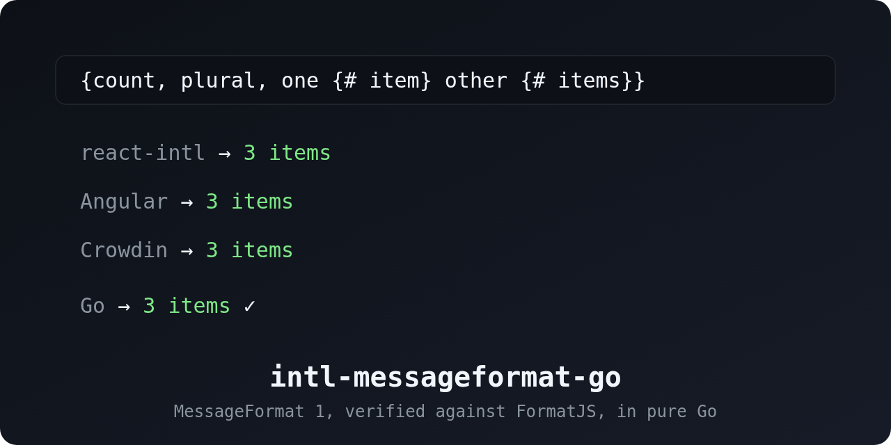

<div align="center">
  
  <h1>intl-messageformat-go</h1>
  <p><strong>ICU MessageFormat 1 for Go, verified byte-for-byte against intl-messageformat (FormatJS) 12.1.5 on 5,505 differential checks.</strong></p>

</div>

Your product already has its messages in MessageFormat: react-intl, FormatJS, Angular's i18n, Crowdin and Lokalise all speak it. When part of the stack runs Go (APIs, email renderers, notification workers, CLIs), those messages could not render there. Porting them to Go templates means rewriting every plural rule by hand and losing the translator-facing syntax your localization pipeline depends on. This package renders the same messages in Go with the same output: plural categories from generated CLDR 48 data, locale-correct numbers, dates and rich text, checked against the reference implementation on the corpus described in [Compatibility evidence](#compatibility-evidence).

```bash
go get github.com/ofershap/intl-messageformat-go
```

No cgo, no dependencies. The CLDR 48 locale data (766 locales) is generated Go source compiled into the package.

```go
mf, _ := messageformat.New("he", "{count, plural, one {הודעה אחת} other {# הודעות}}")
out, _ := mf.Format(map[string]any{"count": 5})
// "5 הודעות"
```

## Supported subset

- Simple arguments: `Hello {name}`
- `select`, `plural`, `selectordinal` with `offset:` and `=N` exact selectors
- `#` inside plural bodies (formats value minus offset)
- Nested messages (plural inside select, and so on)
- Numbers: `{n, number}`, `integer`, `percent`, and named custom formats via `WithNumberFormats` (currency included)
- Dates and times: `{d, date, full|long|medium|short}` and the same for `time`, at UTC, with the exact style mapping FormatJS 12 uses (which is not `Intl.DateTimeFormat`'s `dateStyle`/`timeStyle`)
- Rich-text tags through `TagFunc`: `Click <b>{what}</b>`
- FormatJS apostrophe quoting (`'{'`, `''`, `'#'`)

## Deliberate exclusions (typed errors, never silent wrong text)

Valid MessageFormat that uses these returns a descriptive error instead of wrong output:

- Number and date/time skeletons (`::currency/USD`, `::yyyyMMdd`)
- User-supplied date pattern strings (`{d, date, yyyy-MM-dd}`). FormatJS 12 silently ignores these and falls back to medium; this package tells you instead.
- Non-Gregorian default calendars
- Time zones other than UTC: `time.Time` values are rendered at UTC. Convert before formatting for other zones.

## Compatibility evidence

Every behavior above is pinned by golden fixtures generated from the reference implementation and compared exactly:

| Corpus | Checks | Reference |
| --- | --- | --- |
| Messages (parser + formatter) | 855 | intl-messageformat 12.1.5 |
| Numbers | 2,700 (450 values x 6 styles) | Intl.NumberFormat |
| Dates and times | 720 (90 instants x 8 styles) | Intl.DateTimeFormat |
| Plural categories | 1,230 | Intl.PluralRules |

Reference environment: Node v22.23.4, ICU 78.3, Unicode 17.0, CLDR 48.0. The fixture generator, its pinned lockfile and all fixtures live in `testdata/`, so the corpus is reproducible. "Verified" means byte-identical output on this corpus across the 15 exercised locales (en, he, ar, ar-EG, ru, pl, cy, ja, zh, ko, fr, de, es, pt-BR, hi), not a claim of universal equivalence on every possible message.

The differential approach also documents where JavaScript itself is surprising: V8 plural-category behavior on exponent-form numbers, FormatJS 12 silently dropping user date patterns, and its use of `timeZoneName: 'short'` for both long and full time styles are covered by tests.

<details>
<summary><strong>FAQ: ICU MessageFormat in Go, FormatJS on the server, react-intl message reuse</strong></summary>

**Can I use my react-intl / FormatJS messages from Go?**
Yes. That is the main use case. The same message catalog (simple args, select, plural, selectordinal, rich text) renders here with the output pinned against intl-messageformat 12.1.5 on the differential corpus.

**Is this a port of @formatjs/icu-messageformat-parser?**
It implements the same MessageFormat 1 grammar (tags included) and is verified against the reference runtime's output, but it is independent Go code with no FormatJS source inside.

**Does it support ICU skeletons like `::currency/USD`?**
Not in v1. Skeleton styles return a typed error. Use `{n, number, integer|percent}` or a named custom format via `WithNumberFormats` for currency.

**Which locales and calendars?**
Plural, number and Gregorian date/time data for 766 locales from CLDR 48.0. Locales whose default calendar is not Gregorian return a typed error rather than wrong dates.

**What about time zones?**
Values render at UTC, matching a `timeZone: 'UTC'` reference setup. Convert your `time.Time` before formatting for other zones.

**What else exists for MessageFormat in Go?**
As of 2026-11-14 searches: a small MessageFormat 2 draft port, a few early-stage MF1 parsers without CLDR-backed formatting, and file-format parsers. Nothing else rendering MF1 with generated CLDR 48 data verified against a FormatJS corpus was found.

</details>

## Related projects

For the JavaScript side of your stack, use [FormatJS](https://formatjs.github.io/) itself. If you need the lunr.js search engine in Go: [lunr-go](https://github.com/ofershap/lunr-go). More Go ports verified against their JS originals: [handlebars-go](https://github.com/ofershap/handlebars-go), [json5](https://github.com/ofershap/json5), [fuse-search](https://github.com/ofershap/fuse-search).

## Contributing

Issues and PRs welcome - see [CONTRIBUTING.md](CONTRIBUTING.md). Please report security issues privately per [SECURITY.md](SECURITY.md).

---

More projects: [gitshow](https://github.com/ofershap/gitshow) · [real-browser-mcp](https://github.com/ofershap/real-browser-mcp) · [cursor-usage-tracker](https://github.com/ofershap/cursor-usage-tracker) · [mcp-server-markdown](https://github.com/ofershap/mcp-server-markdown) · [readme-builder](https://github.com/ofershap/readme-builder) · [grok-bot-skills](https://github.com/ofershap/grok-bot-skills) · [mashov-parent-brief](https://github.com/ofershap/mashov-parent-brief) · [gailwind](https://github.com/ofershap/gailwind) · [lather](https://github.com/ofershap/lather)

---

## Author

[](https://gitshow.dev/ofershap)

[](https://linkedin.com/in/ofershap)
[](https://github.com/ofershap)
[](https://ofershap.github.io/)

---

<sub>README built with [README Builder](https://ofershap.github.io/readme-builder/)</sub>

## License

[MIT](LICENSE) &copy; [Ofer Shapira](https://github.com/ofershap). Generated locale data derives from Unicode CLDR 48.0 under the Unicode License v3; see [NOTICE](NOTICE).
